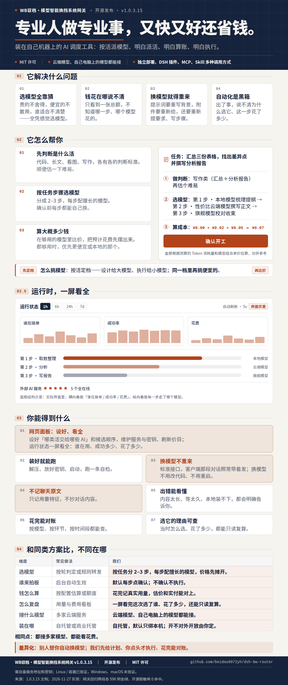

# WB驭档·模型智能换挡系统（网关 + DSH 插件 + Skill/MCP）

**把「这次该用哪个模型、这一步要花多少钱」变成一次看得见、可确认、可复盘的流程——你点同意，它才花钱。**

[](docs-open/WB-Router-Poster@2x.png)

> 点海报看 2160×5120 原图（[直接下载](docs-open/WB-Router-Poster@2x.png)）｜可编辑源：[WB-Router-Poster.html](docs-open/WB-Router-Poster.html)

本仓库是 **WB驭档·模型智能换挡系统 1.0.3.15** 的开源发布仓，含：

| 路径 | 是什么 |
|---|---|
| `gateway/` | Python 单进程、OpenAI 兼容的WB驭档·模型智能换挡系统网关（规划 → 确认 → 逐段执行 → 回写真实花费） |
| `dsh-wb-max/` | DSH Max 插件 0.2.5：网关形态的前端入口（计划卡、确认、会话内切模型） |
| `dsh-wb-pro/` | DSH Pro 插件 0.2.5：DSH 原生规划的模型路由（不依赖网关） |
| 仓库根（`dsh-bw-router`） | B&W联合插件 0.2.5；沿用历史发布名 |
| `skill-mcp/` | `wb-max-router` 技能与 `wb-max-mcp` MCP 服务 |
| `docs-open/` | 使用说明书、快速上手、Agent 安装说明、开源海报（md/html/pdf） |
| `release-notes-1.0.3.15/` | 变更说明、测试清单、开关与观察、包校验说明 |

> **版本**：`1.0.3.15`（2026-11-27）。本版为公开件脱敏第三轮整改：整族内部任务号、历史包内内部文档与内测编号清零；修插件鉴权兜底缺陷；统一署名。产品代码功能零改动，路由算法与账本口径不变。
> **许可**：MIT。**默认只绑 `127.0.0.1`**；管理面请勿对公网开放。

## 一、快速开始（三件包）

从 [Release v1.0.3.15](https://github.com/beidou6972yh/dsh-bw-router/releases/tag/v1.0.3.15) 下载：

```sh
mkdir -p ~/wb-router && cd ~/wb-router
tar -xzf gateway-1.0.3.15.tar.gz
tar -xzf plugins-1.0.3.15.tar.gz
tar -xzf skill-mcp-1.0.3.15.tar.gz
ls   # gateway  plugins  skill-mcp
```

1. `gateway/config/` 内是**匿名样例**（`up-a…local-lan`、`.example.com`），换成你自己的上游与密钥（密钥只放环境变量）。
2. 装两个 Python 依赖：`pip install PyYAML requests`。
3. 启动：`python3 gateway/main.py`（默认 `127.0.0.1:18790`），`curl http://127.0.0.1:18790/health` 应返回 200。
4. 回归：`cd gateway && bash run-tests.sh --clean --config-dir config`（两段各 `Ran 579 / OK`）。

> **价与汇率**：`config/pricebook.json`、`config/fx-rates.json` 都是**样例**，只让开箱能算出「预计花费」。接真实上游后请按官方价更新 pricebook；USD 计价上游必须把 `fx-rates.json` 的 `USDCNY` 换成当日汇率（或跑 `scripts/fx_sync.py --write`），缺该键时网关判「价未知、不猜价」，不会把没价当免费。
> **币种（1.0.3.15）**：pricebook 顶层 `currency` 是默认币种，单个 offer 可用 `currency` 覆盖；样例 `model-usd-fast` 即 USD 报价，`GET /v1/route/prices?model=model-usd-fast` 可直接验。

详细步骤见 [`docs-open/WB-Router-User-Guide.v1.0.0.md`](docs-open/WB-Router-User-Guide.v1.0.0.md)、[`docs-open/WB-Router-Quick-Start.md`](docs-open/WB-Router-Quick-Start.md) 与 [`gateway/INSTALL.md`](gateway/INSTALL.md)。

## 二、DSH 插件

需要 DeepSeek Harness `0.2.1-rc.2` 或同线版本，Node.js `>=20`。

```sh
# 联合插件（本仓根，历史发布名）
dsh plugin --profile web add 'https://github.com/beidou6972yh/dsh-bw-router/releases/download/v1.0.3.15/dsh-bw-router-0.2.5.tgz'

# WB-GearPilot Max / Pro（Release 资产）
dsh plugin --profile web add 'https://github.com/beidou6972yh/dsh-bw-router/releases/download/v1.0.3.15/dsh-wb-max-0.2.5.tgz'
dsh plugin --profile web add 'https://github.com/beidou6972yh/dsh-bw-router/releases/download/v1.0.3.15/dsh-wb-pro-0.2.5.tgz'
```

装完重启一次承载插件的宿主（`dsh web`）。三个包都声明 `dsh.bundle`，装后自动启用。

> 插件的 HTTP 路由在入口先过 DSH 连接信任检查（`ctx.connection.requestRejection`）：**未经 DSH 认证的请求会被当场拒掉（401/403）**，因此脚本或 `curl` 不能再用免检方式直连这些路由，需要 DSH 的浏览器认证或 API 凭据。

## 三、网关能力（1.0.3.15）

- **规划/确认/执行/回写**：`POST /v1/route/plan` → 用户确认 → `POST /v1/chat/completions`（OpenAI 兼容，支持流式）→ `POST /v1/route/annotation`。
- **B1 边界纪律**：plan 每段只读 `boundary_policy`；`GET /v1/route/discipline` 只读聚合；违约只记账不阻断。
- **B2 报告/回放**：`GET /v1/route/report`、`POST /v1/route/replay`（只读复算，0 执行 0 写账）、`/admin/review`。
- **B3 自动化档位**：`automation_level=L1/L2/L3`（只改确认节奏，不改选模；不传＝现状）。
- **B4 影子判定**（默认关）：`/v1/route/shadow`、`/health.shadow`；异步、失败丢弃、不改选模。
- **B5 只读兼容入口**（默认关）：`X-WB-Route-Mode: passthrough`＋per-key；响应头 `X-WB-Model/Strategy/Usage-Kind`。
- **A0 价格单源**：`config/pricebook.json` 唯一真源；`ROUTER_PRICE_ATTEST=1` 单源自证。
- **币种与折算（1.0.3.15）**：pricebook 可按 offer 标币种；plan 成本一律折 CNY（3 位小数），缺汇率判「价未知」。
- **R4/R5 上下文治理**：`context_governor=shadow`（默认观测）；预算＝窗口−max(1024, ⌈0.2×窗口⌉)；超窗结构化 400；超时 read 270s / stream 600s；trim/413 默认关。
- **观测**：账本 `ctx_gov` 与 `X-DSH-Context-*` / `X-DSH-Band` 响应头。

## 四、仓库根插件：B&W dsh-bw-router（0.2.5）

**B&W = 小棒（B棒）× 灰狼（Wolf）** 合作的 DeepSeek Harness 模型路由插件：把任务拆成分段计划、按段挑模型、同一会话内切模型而不丢上下文；成本要么给出依据、要么明示不可用，绝不编数。

| 方法 | 路径 | 说明 |
|---|---|---|
| GET | `/router/models` | 模型发现（`count`/`sources`/`filesRead`/`pricing`） |
| POST | `/router/plan` | 生成分段计划与计划卡 |
| POST | `/router/plan/confirm` | 确认开工（可带 `sessionId`） |
| POST | `/router/plan/swap` | 开工前给某段换模型 |
| GET | `/router/state` / `/router/card` | 状态栏 / 计划卡数据 |
| POST | `/router/switch` / `/router/stage/finish` | 切模型 / 段末记账 |
| GET | `/router/wizard`、`/router/context`、`/router/reconcile` | 只读辅助视图 |

## 五、历史 1.0.3.6 更新要点

1. **价目支持币种**：pricebook 顶层/offer 级 `currency`；plan 成本按 `fx-rates.json` 折 CNY，缺汇率判「价未知」；样例新增 USD 报价 `model-usd-fast`。
2. **AFP 快照统计口径**：坏内容每次读取都计 `snapshot_missing`（只影响观测，不改变放行行为）。
3. **回归用例订正**：`test_read_and_mtime_cache` → `test_read_and_content_cache`，补 mtime 断言，锁死「缓存只看内容字节」。
4. **公开包清洗**：源码与文档里的内部路径/内部文档名全部移除；gateway / plugins / skill-mcp / docs-open 全量过开源脱敏扫描（0 命中）。
5. **发布可核**：Release 资产附 `SHA256SUMS.txt` 与 64 位 `RELEASE-SHA256.txt`，发布说明直接引用整串 sha（不再手输）。

完整差异见 `release-notes-1.0.3.15/`。

## 六、开发与验证

```sh
# 网关回归（两段：配置无关 / 生产等价）
cd gateway && bash run-tests.sh --clean

# 根插件（需要本机有源码构建环境）
npm ci && npm test && npm run build
```

## 七、已知边界

- 本仓 `dsh-wb-max/dist/client/client.js` 为**脱敏副本**：余额快照 `SNAP` 已清空（`items:[]`），不含任何真实金额。生产环境的余额注入属本地运维件，不随开源发布。
- 信任闸为 **fail-closed**：宿主不提供 `connection` 服务、`requestRejection` 抛错或返回非数字（含 `null`）时，路由一律答 403 而不放行；只有宿主显式返回 `undefined` 才按 0.2.0 的行为放行。
- `context_governor` 的 **enforce 灰度未开**（shadow 标定样本不足，需低峰窗口与数据）。
- 明确不做：413 默认出口、精确 tokenizer、订阅额度穿透；B1 插件面 per-tool-call/turn-boundary（插件标准面无该事件，以网关 `discipline` 记账兜底）。
- **平台**：Linux / 容器已验证；**Windows 首次启动需 `pip install tzdata`**（标准库 ZoneInfo 缺时区库），macOS 未验证。
- **入口边界**：`dsh-wb-pro` / `dsh-wb-max` 是 DSH 宿主插件（`engines.dsh`、`platform: web`，需 `dsh plugin add` 并重启 `dsh web`）；**网关、MCP、Skill 三个入口可脱离 DSH 独立运行**。
- **MCP 凭据**：网关未启用鉴权时不需 key；启用 `ROUTER_API_KEY` 后，MCP 侧用 `WB_GATEWAY_API_KEY` 或 `WB_GATEWAY_KEY_FILE`（默认 `~/.wb-router/wb-remote.json`，形如 `{"token":"…"}`，权限 600）。

## 八、许可

MIT © B&W
